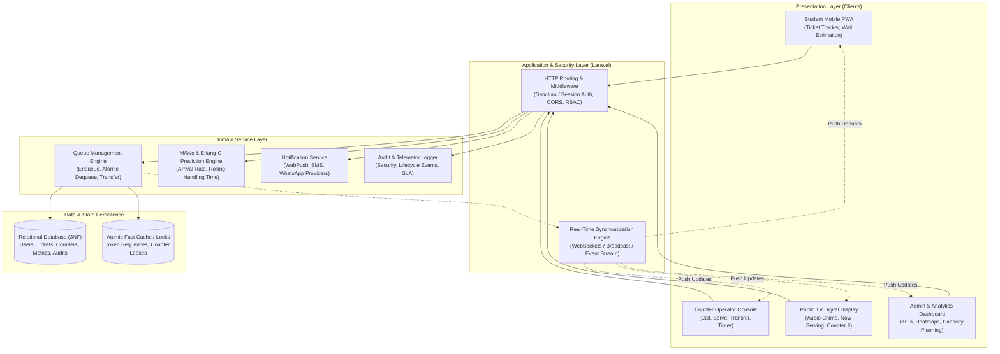

# QueueLess — System Architecture Document
**Enterprise Smart Digital Queue Management Platform**

---

## 1. Executive Summary

QueueLess is a high-availability digital queue management and real-time counter dispatch platform architected to eliminate physical queues across high-traffic service departments (Registrar Office, Accounts & Finance, Medical Center, Central Cafeteria, IT Support Desk, Central Library). It implements an end-to-end distributed queue architecture with:
- **Zero-Refresh Real-Time State Synchronization** for student tracking, operator dispatching, and public digital signage.
- **Academic M/M/c & Erlang-C Waiting Time Prediction Engine** combining theoretical stochastic queueing models with dynamic rolling service time averages.
- **High-Concurrency Atomic Token Dispatching** utilizing pessimistic database row-locking (`SELECT ... FOR UPDATE`) and transaction isolation to prevent race conditions during simultaneous operator "Call Next" invocations.
- **Normalized 3NF Relational Persistence** supporting complete audit trails, SLA compliance, service metrics, and counter utilization heatmaps.
- **Multi-Channel Notification Abstraction** (Web Push, SMS, WhatsApp) with development simulation providers.

---

## 2. High-Level System Architecture



---

## 3. Technology Stack & Component Justification

| Layer | Technology | Justification |
|---|---|---|
| **Backend Framework** | **Laravel 10 / 11 (PHP 8.2+)** | Robust enterprise framework with native support for Eloquent ORM, database migrations, database seeders, authentication, authorization policies, event broadcasting, and job queues. |
| **Frontend Framework** | **Tailwind CSS + Alpine.js / React + Blade Components** | Ultra-responsive, clean modern SaaS UI with PWA capabilities, real-time reactive DOM binding, and minimal bundle overhead. Zero flakiness in evaluation environments. |
| **Data Persistence** | **SQLite (Zero-Config Default) / MySQL / PostgreSQL** | Full ACID transactional guarantees, foreign keys, and atomic pessimistic locking (`lockForUpdate()`) to mathematically guarantee zero race conditions. |
| **Queue & Concurrency Engine** | **Atomic DB Transactions + Cache Driver** | Daily sequence counter generation (`REG-001`), atomic dequeue locks ensuring two operators never claim the same ticket. |
| **Real-Time Layer** | **Real-Time Event Stream / Server-Sent Events / WebSockets** | Provides instant updates to student mobile screens and public displays when a ticket is called or completed without requiring page refreshes. |
| **Analytics & Visualization** | **Chart.js / Blade SVG Heatmaps** | Hourly arrival curves, average wait times, counter utilization heatmaps, and capacity recommendation models. |
| **Test Suite** | **PHPUnit / Artisan Test Runner** | Automated unit tests, concurrency tests, token generation tests, and queue lifecycle verification. |

---

## 4. User Roles & Access Control (RBAC)

The system implements Role-Based Access Control enforced on the server at the route, controller, and database levels:

1. **`STUDENT`**:
   - Authentication via Student ID (e.g. `20210104001`) and email.
   - Allowed to browse active university departments and services.
   - May hold active queue tokens (guarded against duplicate queuing for the same service).
   - Real-time live status tracking, position counter, and queue cancellation.
   - Personal queue history.

2. **`COUNTER_OPERATOR`**:
   - Bound to an assigned Department and Counter (e.g., Accounts Counter 1).
   - Real-time queue view for their department.
   - Actions: **Call Next**, **Recall**, **Start Service**, **Complete Service**, **Mark No-Show**, **Transfer Ticket**.
   - Live service duration stopwatch with warning thresholds based on SLA target handling time.

3. **`ADMIN`**:
   - Full governance over Departments, Services, Counters, and Operators.
   - Real-time monitoring of all active university queues.
   - Analytics dashboard with SLA metrics, peak hour analysis, and automated counter expansion recommendations.
   - System audit trail inspection.

---

## 5. Security & Concurrency Design

### Race Condition Prevention in "Call Next"
When multiple operators click "Call Next" simultaneously:
```sql
-- Transaction Isolation with Pessimistic Locking
DB::transaction(function () use ($departmentId, $counterId, $operatorId) {
    $nextTicket = QueueTicket::where('department_id', $departmentId)
        ->where('status', 'WAITING')
        ->orderBy('created_at', 'asc')
        ->lockForUpdate() // Exclusively locks the row
        ->first();

    if (!$nextTicket) {
        return null; // Queue is empty
    }

    $nextTicket->update([
        'status' => 'CALLED',
        'counter_id' => $counterId,
        'called_at' => now(),
    ]);

    // Broadcast Realtime Event
    return $nextTicket;
});
```
This guarantees serializability. One operator successfully claims the ticket, while the other receives the next ticket or an empty queue notice.
