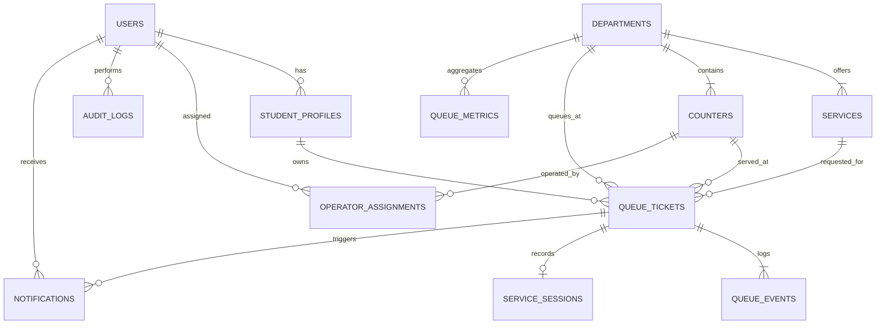

# QueueLess — Database Design & Schema Specification (3NF)

---

## 1. Database Relational Model & Normalization

The QueueLess schema is normalized to **Third Normal Form (3NF)**:
1. **1NF**: All attributes contain atomic values; every table contains a primary key.
2. **2NF**: All non-key attributes are fully functionally dependent on the entire primary key (no partial dependencies).
3. **3NF**: No transitive dependencies exist. Derived queue metrics and history are decoupled from primary operational state.

---

## 2. Entity-Relationship Diagram (ERD)



---

## 3. Entity Definitions & DDL Specifications

### 1. `users`
Core identity table supporting Authentication & Role-Based Access Control.
- `id` (BIGINT, PK, AUTO_INCREMENT)
- `name` (VARCHAR 150)
- `email` (VARCHAR 150, UNIQUE)
- `password` (VARCHAR 255, Hashed with bcrypt)
- `role` (ENUM: `ADMIN`, `COUNTER_OPERATOR`, `STUDENT`)
- `phone` (VARCHAR 25, NULLABLE)
- `remember_token` (VARCHAR 100, NULLABLE)
- `created_at`, `updated_at` (TIMESTAMP)

### 2. `student_profiles`
Extended profile for student-specific academic information.
- `id` (BIGINT, PK, AUTO_INCREMENT)
- `user_id` (BIGINT, FK -> `users.id`, UNIQUE, CASCADE DELETE)
- `student_id_number` (VARCHAR 50, UNIQUE) — e.g. `20210104001`
- `department_name` (VARCHAR 100) — e.g. `CSE`, `EEE`, `ME`, `CE`, `BBA`
- `batch` (VARCHAR 20) — e.g. `14th Batch`
- `created_at`, `updated_at` (TIMESTAMP)

### 3. `departments`
University operational divisions handling student services.
- `id` (BIGINT, PK, AUTO_INCREMENT)
- `code` (VARCHAR 10, UNIQUE) — e.g. `REG`, `ACC`, `MED`, `CAF`, `ITS`, `LIB`
- `name` (VARCHAR 150) — e.g. `Registrar Office`, `Accounts & Finance`
- `description` (TEXT, NULLABLE)
- `location` (VARCHAR 150) — e.g. `Academic Building 1, Room 204`
- `avg_handling_time_min` (INT) — Default estimated benchmark in minutes
- `is_active` (BOOLEAN, DEFAULT true)
- `created_at`, `updated_at` (TIMESTAMP)

### 4. `services`
Specific service types offered by each university department.
- `id` (BIGINT, PK, AUTO_INCREMENT)
- `department_id` (BIGINT, FK -> `departments.id`, CASCADE DELETE)
- `name` (VARCHAR 150) — e.g. `Tuition Fee Payment`, `Transcript Request`
- `code` (VARCHAR 20) — e.g. `TFP`, `TRANS`
- `description` (TEXT, NULLABLE)
- `estimated_duration_min` (INT) — Benchmark duration
- `is_active` (BOOLEAN, DEFAULT true)
- `created_at`, `updated_at` (TIMESTAMP)

### 5. `counters`
Physical or virtual service desks inside each department.
- `id` (BIGINT, PK, AUTO_INCREMENT)
- `department_id` (BIGINT, FK -> `departments.id`, CASCADE DELETE)
- `counter_number` (INT) — e.g. `1`, `2`, `3`
- `name` (VARCHAR 100) — e.g. `Counter 1 (General)`, `Counter 2 (Clearance)`
- `status` (ENUM: `AVAILABLE`, `BUSY`, `ON_BREAK`, `OFFLINE`)
- `created_at`, `updated_at` (TIMESTAMP)

### 6. `operator_assignments`
Tracks which counter operator is actively seated at which counter.
- `id` (BIGINT, PK, AUTO_INCREMENT)
- `user_id` (BIGINT, FK -> `users.id`)
- `counter_id` (BIGINT, FK -> `counters.id`)
- `started_at` (TIMESTAMP)
- `ended_at` (TIMESTAMP, NULLABLE)
- `status` (ENUM: `ACTIVE`, `COMPLETED`)

### 7. `queue_tickets`
The central operational ticket entity representing a student in queue.
- `id` (BIGINT, PK, AUTO_INCREMENT)
- `ticket_number` (VARCHAR 30, INDEXED) — e.g. `ACC-001`, `REG-014`
- `sequence_number` (INT) — Daily incremental integer (1, 2, 3...)
- `department_id` (BIGINT, FK -> `departments.id`)
- `service_id` (BIGINT, FK -> `services.id`)
- `student_profile_id` (BIGINT, FK -> `student_profiles.id`)
- `counter_id` (BIGINT, FK -> `counters.id`, NULLABLE)
- `operator_id` (BIGINT, FK -> `users.id`, NULLABLE)
- `status` (ENUM: `WAITING`, `CALLED`, `SERVING`, `COMPLETED`, `CANCELLED`, `NO_SHOW`, `TRANSFERRED`)
- `estimated_wait_time_min` (INT, DEFAULT 0)
- `joined_at` (TIMESTAMP)
- `called_at` (TIMESTAMP, NULLABLE)
- `served_at` (TIMESTAMP, NULLABLE)
- `completed_at` (TIMESTAMP, NULLABLE)
- `notes` (TEXT, NULLABLE)
- `created_at`, `updated_at` (TIMESTAMP)

### 8. `queue_events`
Audit timeline for every transition in the ticket lifecycle.
- `id` (BIGINT, PK, AUTO_INCREMENT)
- `queue_ticket_id` (BIGINT, FK -> `queue_tickets.id`, CASCADE DELETE)
- `actor_id` (BIGINT, FK -> `users.id`, NULLABLE)
- `event_type` (VARCHAR 50) — `JOINED`, `CALLED`, `RECALLED`, `SERVICE_STARTED`, `SERVICE_COMPLETED`, `NO_SHOW`, `TRANSFERRED`, `CANCELLED`
- `payload` (JSON, NULLABLE)
- `created_at` (TIMESTAMP)

### 9. `service_sessions`
High-resolution timing telemetry for served tickets to feed M/M/c rolling averages.
- `id` (BIGINT, PK, AUTO_INCREMENT)
- `queue_ticket_id` (BIGINT, FK -> `queue_tickets.id`, UNIQUE)
- `counter_id` (BIGINT, FK -> `counters.id`)
- `operator_id` (BIGINT, FK -> `users.id`)
- `started_at` (TIMESTAMP)
- `ended_at` (TIMESTAMP)
- `duration_seconds` (INT)
- `sla_status` (ENUM: `WITHIN_SLA`, `BREACHED_SLA`)

### 10. `queue_metrics`
Periodic aggregated analytical snapshots for historical reporting and capacity planning.
- `id` (BIGINT, PK, AUTO_INCREMENT)
- `department_id` (BIGINT, FK -> `departments.id`)
- `metric_date` (DATE)
- `hour_of_day` (INT) — 0 to 23
- `total_arrivals` (INT)
- `total_served` (INT)
- `total_no_shows` (INT)
- `total_cancelled` (INT)
- `avg_wait_seconds` (DOUBLE)
- `avg_service_seconds` (DOUBLE)
- `peak_queue_length` (INT)
- `counter_utilization_pct` (DOUBLE)

### 11. `notifications`
Multi-channel notification logs.
- `id` (BIGINT, PK, AUTO_INCREMENT)
- `user_id` (BIGINT, FK -> `users.id`)
- `queue_ticket_id` (BIGINT, FK -> `queue_tickets.id`, NULLABLE)
- `channel` (ENUM: `IN_APP`, `WEB_PUSH`, `SMS`, `WHATSAPP`)
- `title` (VARCHAR 150)
- `message` (TEXT)
- `status` (ENUM: `QUEUED`, `SENT`, `DELIVERED`, `FAILED`)
- `created_at` (TIMESTAMP)

### 12. `audit_logs`
System-wide security and compliance telemetry.
- `id` (BIGINT, PK, AUTO_INCREMENT)
- `user_id` (BIGINT, FK -> `users.id`, NULLABLE)
- `action` (VARCHAR 100) — e.g. `USER_LOGIN`, `TICKET_CANCELLED`, `DEPARTMENT_UPDATED`
- `target_type` (VARCHAR 100, NULLABLE)
- `target_id` (BIGINT, NULLABLE)
- `ip_address` (VARCHAR 45, NULLABLE)
- `user_agent` (TEXT, NULLABLE)
- `details` (JSON, NULLABLE)
- `created_at` (TIMESTAMP)

---

## 4. Key Indexes for High Performance Real-Time Operations

```sql
-- Fast lookup of waiting tickets per department sorted chronologically
CREATE INDEX idx_tickets_dept_status_created ON queue_tickets (department_id, status, created_at);

-- Fast lookup for currently serving tokens per counter
CREATE INDEX idx_tickets_counter_status ON queue_tickets (counter_id, status);

-- Fast lookup for a student's active tickets to prevent double booking
CREATE INDEX idx_tickets_student_status ON queue_tickets (student_profile_id, status);

-- Fast search by human-readable token number
CREATE INDEX idx_tickets_number ON queue_tickets (ticket_number);

-- Metrics aggregation query performance
CREATE INDEX idx_metrics_dept_date_hour ON queue_metrics (department_id, metric_date, hour_of_day);
```
